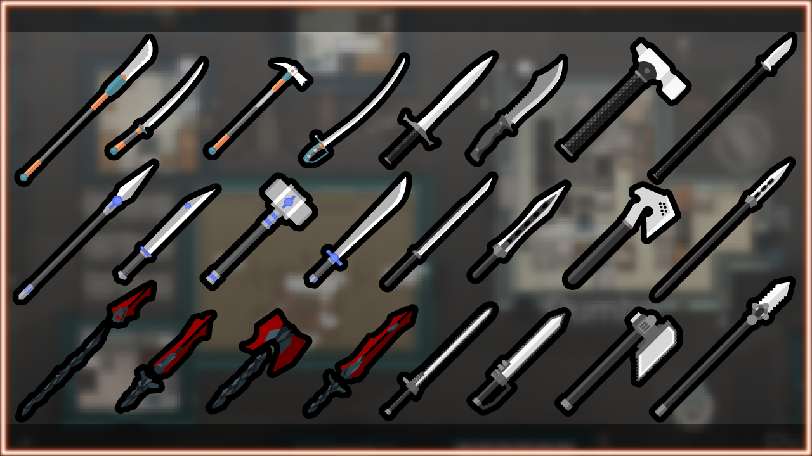

# Melee Weapons For All Post-Medieval Tech Levels

### See everything the mod adds: https://bambaryla-mods.github.io/AllBambaMelee/

A RimWorld mod that adds tiered melee weapons: knife, gladius, longsword, hammer (or axe), polehammer, mace, baton and spear, in Industrial, Spacer and Ultra tiers, each with its own research.

- **Beyond Our Reach :: Redux** (optional) adds Solar, Kwazaari and Tenebral tiers.
- **Combat Extended** (optional) adds a shield for every tier and CE stats for every weapon.

Supports RimWorld 1.6 and 1.7. No required mods.

## Installation

Subscribe on the [Steam Workshop](https://steamcommunity.com/sharedfiles/filedetails/?id=3726524693), or download this repository and put the folder in your RimWorld `Mods` folder. Load it after Beyond Our Reach and Combat Extended if you use them.

## Repository layout

| Path | What |
|---|---|
| `1.6/`, `1.7/` | Defs and patches per game version. `CE/` inside each loads only with Combat Extended. |
| `Languages/`, `Textures/`, `About/` | Shared between versions. |
| `site/` | The player site. Not part of the mod; see [site/README.md](site/README.md). |

## License

[Creative Commons Attribution-NonCommercial-ShareAlike 4.0](LICENSE).
